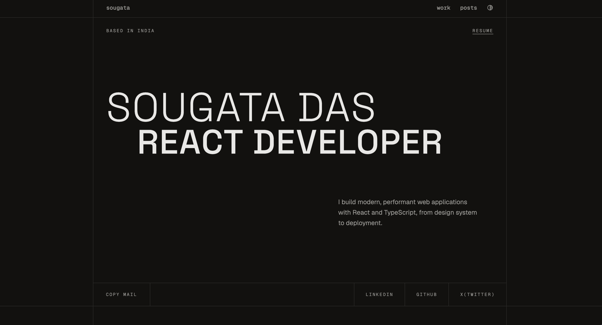

# My Portfolio

This is my personal portfolio site. It showcases my projects and hosts my blog, and it has a contact form that delivers messages straight to my inbox.



## Tech Stack

- [Next.js 16](https://nextjs.org) with the App Router and Turbopack
- [TypeScript](https://www.typescriptlang.org)
- [Tailwind CSS v4](https://tailwindcss.com)
- [shadcn/ui](https://ui.shadcn.com) for UI components
- [Velite](https://velite.js.org) for turning MDX blog posts into typed content
- [Nodemailer](https://nodemailer.com) for the contact form

## Prerequisites

- **Node.js 24.x** (the version is pinned in `.nvmrc` and in `engines` inside `package.json`)
- **pnpm** as the package manager

If you use [nvm](https://github.com/nvm-sh/nvm), switch to the right Node version from the project root:

```bash
nvm install
nvm use
```

If pnpm is not installed yet, enable it through Corepack (ships with Node):

```bash
corepack enable pnpm
```

## Getting Started

### 1. Clone the repository

```bash
git clone https://github.com/sougata-github/my-portfolio.git
cd my-portfolio
```

### 2. Install dependencies

```bash
pnpm install
```

### 3. Generate content with Velite

Blog posts live in `content/blog/` as `.mdx` files. Velite reads them using the schema in `velite.config.ts` and writes typed output to `.velite/`, which the app imports through the `#site/content` path alias.

```bash
pnpm build:content
```

Run this once before starting the dev server, and again whenever you add or edit a post. The `.velite/` folder is generated, so it is not committed.

### 4. Run the development server

```bash
pnpm dev
```

Then open [http://localhost:3000](http://localhost:3000) in your browser.

### 5. Build for production

```bash
pnpm build
```

This runs `build:content` (Velite) first and then `next build`. To serve the production build locally:

```bash
pnpm start
```

## Available Scripts

| Script               | What it does                                 |
| -------------------- | -------------------------------------------- |
| `pnpm dev`           | Starts the Next.js dev server with Turbopack |
| `pnpm build:content` | Generates blog content with Velite           |
| `pnpm build:next`    | Runs `next build` on its own                 |
| `pnpm build`         | Runs Velite and then the Next.js build       |
| `pnpm start`         | Serves the production build                  |

## Writing a Blog Post

Create a new file in `content/blog/`, for example `content/blog/my-post.mdx`, with frontmatter that matches the schema in `velite.config.ts`:

```mdx
---
title: My First Post
description: A short summary shown on the blog listing.
date: 2026-10-11
published: true
category: TypeScript
keywords: ["typescript", "nextjs"]
---

Your post content goes here.
```

Then regenerate the content:

```bash
pnpm build:content
```

## Deploying to Vercel

1. Push the repository to GitHub.
2. Import it in the [Vercel dashboard](https://vercel.com/new).
3. Make sure the Node.js version is set to **24.x**. The `engines` field in `package.json` already requests it.

Vercel runs `pnpm build`, so Velite content is generated as part of every deploy.

## Contributing

Found a bug or have an idea? Feel free to open an issue or submit a pull request. Contributions are always welcome.

## Show Your Support

If this project helped you or gave you ideas for your own portfolio, consider leaving a ⭐ on the repo. It really helps!
